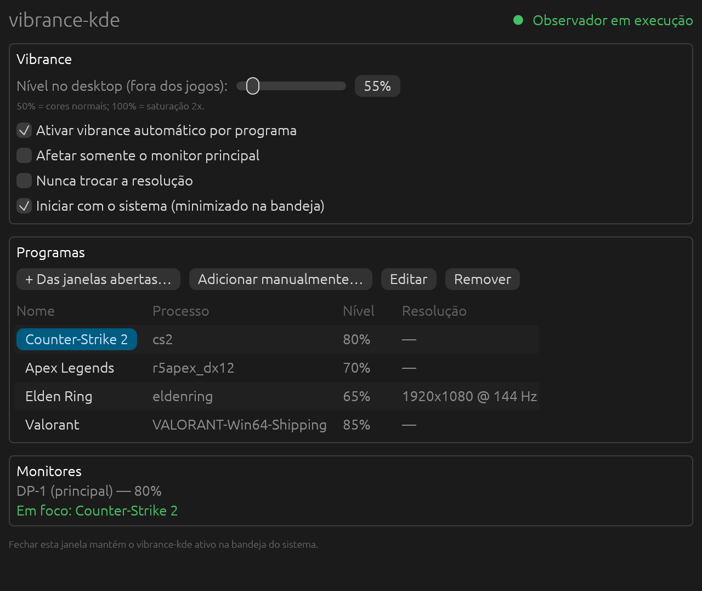
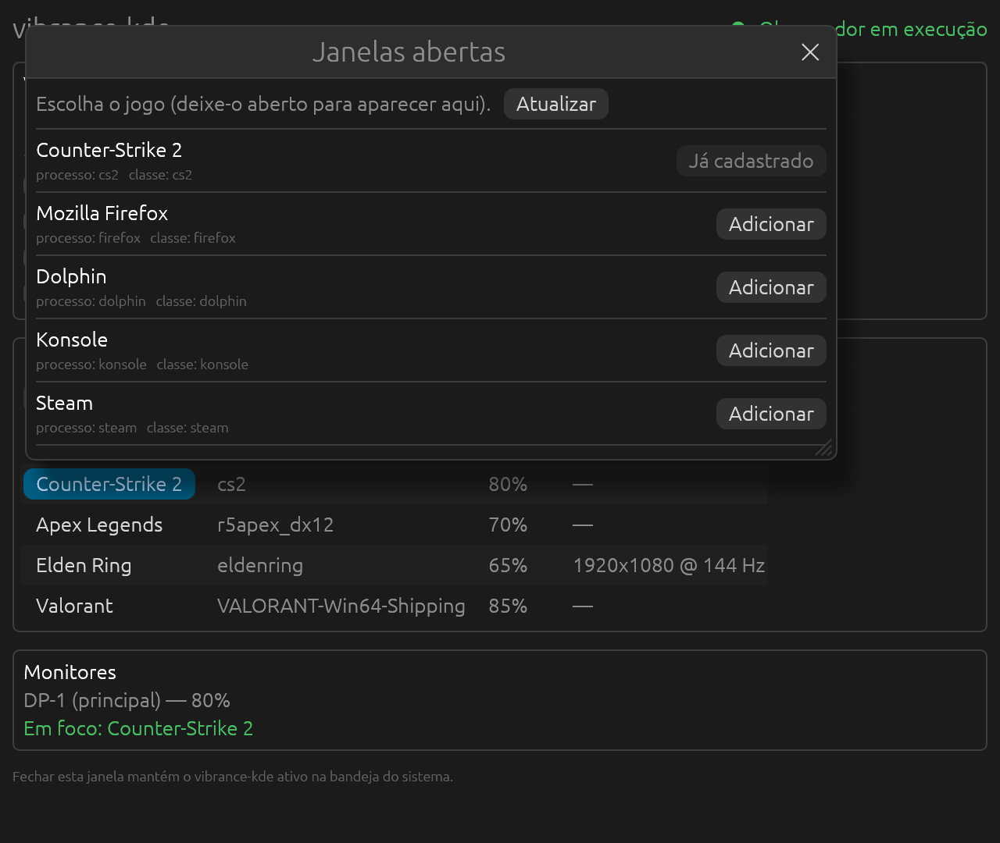
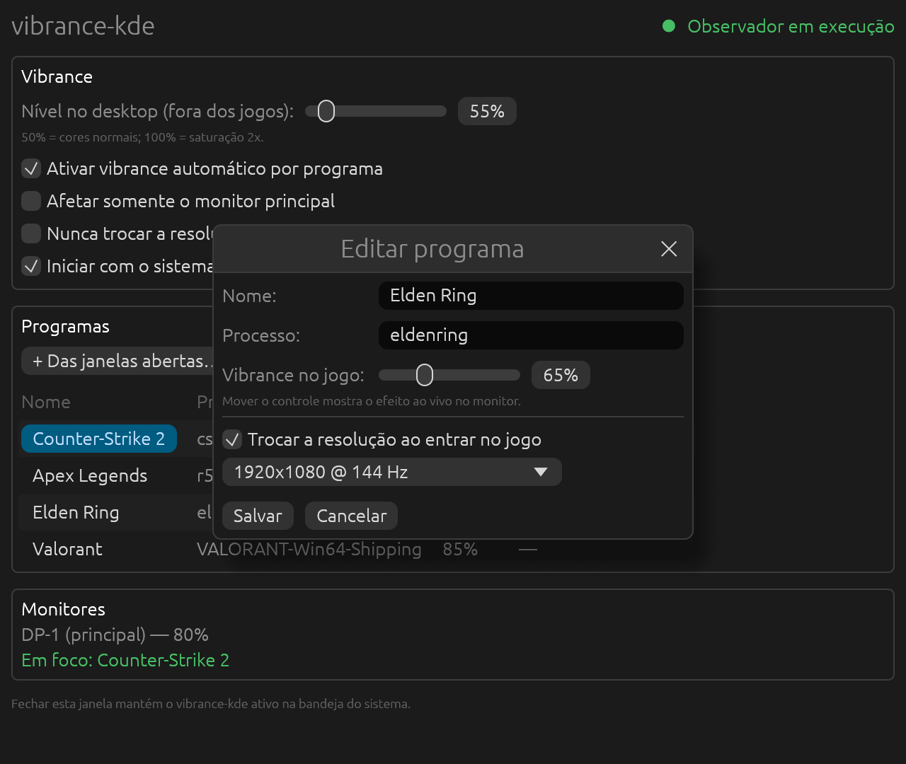
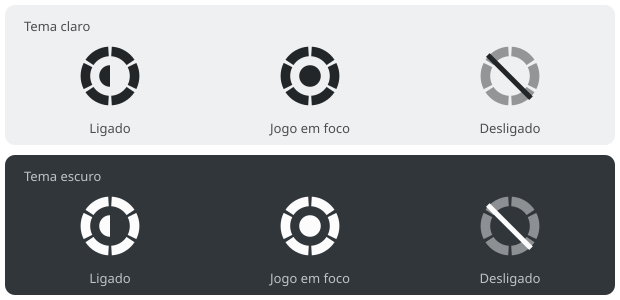

<p align="center">
  
</p>

<h1 align="center">vibrance-kde</h1>

Vibrance (saturação) automático por jogo para **KDE Plasma 6 em Wayland**, no estilo do
vibranceGUI do Windows. Quando a janela de um jogo cadastrado ganha o foco, a saturação do
monitor sobe. Quando você sai dela, volta ao normal.

Feito em Rust, com um processo residente leve (bandeja do sistema, sem interface gráfica carregada)
e uma janela de configurações que só existe quando você a abre.

## Capturas de tela

<p align="center">
  
</p>

<table>
  <tr>
    <td align="center" width="50%">
      <br>
      <sub>Escolha do jogo entre as janelas abertas</sub>
    </td>
    <td align="center" width="50%">
      <br>
      <sub>Nível por jogo, com pré-visualização ao vivo, e troca de resolução</sub>
    </td>
  </tr>
</table>

Ícones da bandeja do sistema, monocromáticos (o Plasma os recolore conforme o tema):

<p align="center">
  
</p>

> As capturas da janela são geradas pelo próprio programa, com **dados de exemplo** (jogos e
> monitor fictícios), e não de uma sessão Plasma real. A interface é desenhada pelo egui, então o
> conteúdo é o mesmo no Plasma; só a moldura da janela vem do KWin. Para gerá-las de novo:
> `cargo run --features screenshots -- screenshots docs/screenshots`.

## Como funciona

| vibranceGUI (Windows) | vibrance-kde (Plasma 6) |
|---|---|
| `SetWinEventHook(EVENT_SYSTEM_FOREGROUND)` | Script do KWin liga `workspace.windowActivated` ao daemon por D-Bus (sem polling) |
| Nome do processo igual ao cadastrado | Mesmo critério, também por classe da janela (`steam_app_730`) e linha de comando (jogos Wine/Proton) |
| NVAPI `SetDVCLevel` / AMD ADL | Perfil ICC com tabela 3D aplicado ao monitor via `kscreen-doctor` |
| Nível "Windows" e nível "ingame" | Nível do desktop e nível por programa (50% = normal, 100% = saturação 2x) |
| Aplica no monitor da janela do jogo | Idem; opção "somente monitor principal" |
| Troca de resolução por jogo / "Never change resolutions" | Idem, via modos do `kscreen-doctor` |
| Restaura ao sair | Restaura cor e resolução ao sair, com `SIGTERM` e depois de queda do programa |
| Autostart com `-minimized` | `~/.config/autostart/vibrance-kde.desktop` com `--minimized` |
| Ícone na bandeja | StatusNotifierItem com ícones monocromáticos (3 estados) |
| Explorador de processos | Lista as janelas abertas para escolher o jogo |
| Slider ao vivo no diálogo do programa | Pré-visualização ao vivo no monitor |

### Por que ICC

No Wayland o compositor é dono do pipeline de cores, e o protocolo de gama não consegue mexer em
saturação (ela mistura canais). O KWin aceita um perfil ICC por monitor, inclusive com tabela 3D
(Plasma 6.1+). O programa gera um perfil que aplica a saturação em espaço gama, igual ao que os
drivers do Windows fazem, e o aplica com `kscreen-doctor`. Nada é injetado no jogo.

## Requisitos

- KDE Plasma 6.1 ou mais novo, sessão Wayland
- `kscreen-doctor` (pacote `libkscreen`/`kscreen`)
- Rust (`rustup`) apenas para compilar do código-fonte
- Em runtime a janela precisa de OpenGL (Mesa) e das bibliotecas Wayland/xkbcommon, que já vêm com o KDE

## Instalação

Três opções. Em todas, o `kscreen-doctor` precisa estar instalado.

**AppImage** (qualquer distro x86_64). Baixe em [Releases](https://github.com/kassiobruno/vibrancekde/releases):

```sh
chmod +x vibrance-kde-*-x86_64.AppImage
./vibrance-kde-*-x86_64.AppImage
```

O atalho do menu e o autostart apontam para o próprio arquivo `.AppImage`, então deixe-o num lugar fixo.

**Arch Linux (AUR)**. O `PKGBUILD` está em `packaging/aur/` e é anexado a cada release já com o
sha256 do tarball. Também há o pacote compilado `*.pkg.tar.zst` anexado:

```sh
sudo pacman -U vibrance-kde-*.pkg.tar.zst
```

**A partir do código-fonte**:

```sh
./install.sh
```

Instala em `~/.local/bin`, cria o atalho no menu, os ícones e o script do KWin. Abra
**vibrance-kde** pelo menu. Para desinstalar: `./uninstall.sh`.

## Uso

1. Abra o jogo.
2. Na janela do vibrance-kde, **+ Das janelas abertas…** e escolha o jogo.
3. Ajuste o **Vibrance no jogo** (a mudança aparece ao vivo no monitor) e salve.
4. Marque **Iniciar com o sistema** para subir minimizado na bandeja.

Fechar a janela mantém o programa ativo na bandeja. Na bandeja: clique esquerdo abre as
configurações, clique do meio liga/desliga, menu de contexto tem as opções e **Sair**
(que restaura os monitores).

Linha de comando:

```
vibrance-kde status               estado do daemon
vibrance-kde list-outputs         monitores e modos de vídeo
vibrance-kde set DP-1 75          aplica 75% manualmente
vibrance-kde reset                remove o vibrance de todos os monitores
vibrance-kde autostart on|off
RUST_LOG=debug vibrance-kde --minimized   mostra os comandos enviados ao kscreen-doctor
```

Configuração: `~/.config/vibrance-kde/config.toml`.

## Limitações conhecidas

- **Substitui o perfil ICC do monitor enquanto o vibrance está ativo.** O estado original
  (fonte de cor, perfil, modo de energia) é guardado e restaurado depois. Se você usa um perfil
  calibrado, ele volta ao sair do jogo, mas não vale durante o jogo.
- O vibrance exige o modo de cor **"preferir precisão"** do KWin, que adiciona uma passada de
  tela cheia por quadro. Em uma GPU como a RX 7900 XTX o custo deve ser desprezível.
- Como nos drivers do Windows, a matriz é linear: cores já saturadas cortam em valores altos.
  Para a maioria dos jogos, 60-80% é um bom ponto.
- Monitores em modo HDR não foram considerados.
- O monitor precisa aceitar perfil ICC (`vibrance-kde list-outputs` informa).

## O que foi e o que não foi verificado

Verificado (no desenvolvimento, em macOS):
- O gerador de perfis ICC em Rust produz arquivos **idênticos byte a byte** aos gerados pelo
  liblcms2 real (script de referência do plasma-vibrance) em seis níveis.
- 18 testes unitários (parser de saída do `kscreen-doctor`, configuração, ICC, nomes de processo).
- Teste de ponta a ponta (`tests/e2e.py`) com o daemon real, D-Bus real, um KWin falso e um
  `kscreen-doctor` falso que valida a sintaxe dos argumentos. Cobre foco, múltiplos monitores,
  resolução, "somente principal", nível do desktop, desligar, pré-visualização, `SIGTERM` e
  recuperação após queda.
- O código compila para `x86_64-unknown-linux-gnu`.
- Os nomes da API de scripts do KWin (`windowActivated`, `windowList`, `Output.name`,
  `/Scripting/Script<id>`, `callDBus`) foram conferidos no código-fonte atual do KWin.

**Não verificado** (precisa de um Plasma real): a aplicação visual do perfil pelo KWin na sua
GPU, o desenho do ícone na bandeja do Plasma, a janela egui em Wayland e o comportamento com jogos
em tela cheia exclusiva. Se a saturação não aparecer em tela cheia, rode com `RUST_LOG=debug` e
verifique com `vibrance-kde set DP-1 80` se o efeito aparece na área de trabalho.

## Licença

GPL-3.0 (veja `LICENSE`). O trecho derivado do plasma-vibrance é MIT, compatível com a GPL-3.0; o
aviso está em `THIRD_PARTY_NOTICES.md`.

## Créditos

A técnica do perfil ICC para o KWin vem do [plasma-vibrance](https://github.com/Celiz/plasma-vibrance)
(MIT). Veja `THIRD_PARTY_NOTICES.md`. O comportamento reproduz o do vibranceGUI, de juvlarN, a partir da
análise do seu funcionamento.
